# 🛫 AURA — 공항 안내·운반 서비스와 응급 대응을 위한 멀티 AMR 시스템

> **조 이름:** E-1 · E-3 · Team **AURA** (Airport User-support & Response AMR)<br>
> **팀원:** 유용준(PM) · 이재영 · 윤태환 · 정진목 · 신초희 · 최인석 · 박수빈<br>
> **지도 멘토:** Andy Kim<br>
> **과정:** [두산로보틱스] 지능형 로보틱스 엔지니어 — 지능-1: SLAM(위치추정 및 공간지도생성) 기반 자율주행 로봇 시스템 구현

<p align="center">
  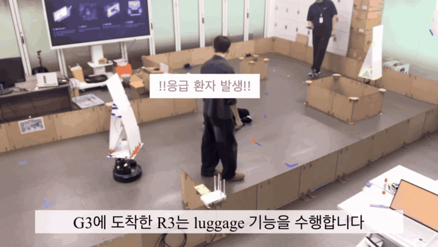
</p>
<p align="center"><i>CCTV가 쓰러진 사람을 감지하면 AED를 실은 robot1이 안내를 멈추고 현장으로 출동합니다 (최종 시연 영상 일부)</i></p>

인천공항처럼 사람이 많이 오가는 공간을 가정해, **TurtleBot4 2대**가 승객 길 안내·짐 운반 동행과 순찰을 맡고,
천장 **CCTV**가 쓰러짐과 혼잡을 감지하면 **AED를 실은 로봇이 현장으로 출동**하는 ROS 2 멀티 AMR 시스템입니다.
중앙 배차 노드가 승객 키오스크 요청과 CCTV 이벤트를 받아 로봇에 미션을 나눠 주고, 관제 대시보드가 로봇 상태와 이벤트 기록을 보여 줍니다.

| 항목 | 내용 |
|:---|:---|
| 프로젝트명 | ROS2를 활용한 인천공항 안내, 운반 서비스 및 상황 감지 AMR 시스템 구현 프로젝트 |
| 로봇 | TurtleBot4 × 2 — **robot1** 응급·AED 대응 / **robot3** 길 안내·짐 운반 |
| ROS 2 패키지 | `fleet_interfaces` · `fleet_central` · `cctv_perception` · `robot1_control` · `robot3_control` (실행 노드 11개) |
| UI | `ui/admin_ui` 관제 대시보드 (Flask, :7000) · `ui/passenger_ui` 승객 키오스크 (Flask, AMR1 :5001 / AMR3 :5003) |
| 워크스페이스 | `~/aura_ws` (이 저장소가 워크스페이스 루트) |
| 코드 규모 | 약 19,900 라인 (ROS 패키지 Python 13,500 · UI Python 3,600 · HTML/JS/CSS 2,800) |
| 코드 상태 | 2026.07 최종 시연 코드 기준. 주석·미사용 코드·패키징만 정리했고 노드 동작 로직은 그대로입니다 |

---

## 1. ⭐ 주요 기능 (Features)

### 1-1. 시나리오 한눈에 보기

| 시나리오 | 시작 조건 | 동작 | 관련 노드 |
|:---|:---|:---|:---|
| **순찰** | 노드 시작 | robot1·robot3가 각자 구역의 6개 지점을 무한 순찰 | `robot1_mission_fsm_node`, `robot3_patrol_node` |
| **길 안내** (GUIDE) | 키오스크에서 목적지 선택 | 순찰을 멈추고 목적지까지 안내. robot3는 180° 돌아 후방 카메라로 승객을 확인하며 이동 | `fleet_dispatcher_node`, `guide_rear_tracker_node`, `guide_motion_node` |
| **짐 운반 동행** (LUGGAGE_ASSIST) | AMR3 키오스크 "짐 싣기 완료" | robot3가 전방 OAK-D로 앞서 걷는 승객의 발목 거리를 재며 따라감 | `luggage_rgbd_tracker_node`, `luggage_follower_node` |
| **혼잡구역 대응** | CCTV가 2명 이상 무리를 2초 연속 감지 | robot1 Nav2 코스트맵에 진입 금지 원을 그려 우회, robot3는 혼잡구역 0.8 m 앞까지 접근 | `cctv_detector_node`, `crowd_keepout_mask_node`, `robot3_patrol_node` |
| **응급 대응** | CCTV가 쓰러짐을 2초 연속 감지 | AED 탑재 로봇에 출동 미션(우선순위 10) → 경고음·제자리 회전 → 현장 대기 → 키오스크 "상황 종료"로 순찰 복귀 | `fleet_dispatcher_node`, `robot1_mission_fsm_node` |

### 1-2. CCTV 인지 — 쓰러짐 · 혼잡 · 인원수 (`cctv_perception`)

<p align="center">
  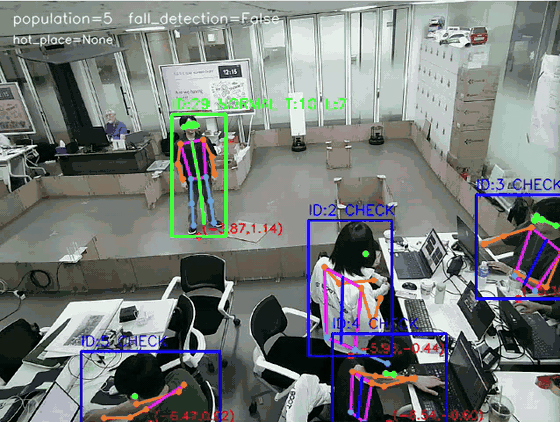
</p>

* **YOLO11x-pose + DeepOCSORT** 추적(conf 0.7, 입력 640)으로 사람별 track ID와 COCO 17 keypoint를 얻습니다.
* **7각형 관심영역(ROI)** 안에 bbox 하단 중앙점이 있는 사람만 집계해 화면 가장자리·외부 오검출을 걸러 냅니다.
* bbox 하단 중앙점을 **바닥 6점으로 맞춘 Homography**로 Nav2 `map` 좌표(m)로 바꿉니다. 보정점 재투영 오차는 평균 약 0.14 m입니다.

<p align="center">
  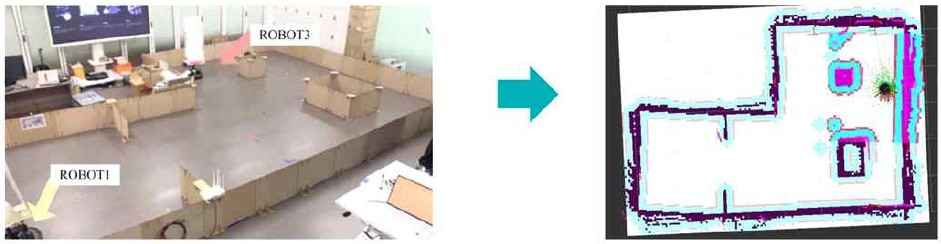
</p>

**쓰러짐 판정** — 몸통축(어깨 중점–골반 중점)과 다리축(골반–발목)의 수직 대비 기울기를 EMA(α 0.7)로 거른 뒤 판단합니다.

| 단계 | 조건 | 값 |
|:---|:---|:---|
| ① 자세 | 몸통 기울기 / 다리 기울기 | ≥ 75° / ≥ 65° |
| ② 움직임 | 몸통 각속도 (최근 0.15 s 안) | ≥ 60°/s — 넘어지는 동작이 있어야 함 |
| ③ 사람별 확정 | ①·② 유지 | 0.05 s → 사람별 FALL 래치 (몸통·다리 ≤ 30°가 1 s 유지되면 해제) |
| ④ 이벤트 확정 | 쓰러진 사람이 있는 상태 유지 | **2.0 s** → `/fall_detection=True` + `/fall_detection_point` 발행 |

**혼잡구역(hot place)** — map 좌표에서 **1.0 m 이내로 이어진 2명 이상**의 무리를 BFS로 찾고, 2.0 s 이어지면 무리 중심을 `/hot_place`(PoseArray)로 발행합니다. 확정 전에는 빈 배열을 보내 받는 쪽이 매 메시지로 상태를 덮어쓰게 했습니다.

**영상 분리** — 관제용 원본 영상은 추론 전에 JPEG로 압축해 **최대 10 FPS**로 `/cctv/image_raw/compressed`에, 이벤트가 확정되는 순간의 오버레이 이미지는 `/cctv/fall_detection_image`·`/cctv/hot_place_image`로 **1회만** 보냅니다(DB 스냅샷용).

### 1-3. 중앙 배차 · 기록 · 진입 금지 구역 (`fleet_central`)

**`fleet_dispatcher_node` — 미션 배차**

| 미션 (`ExecuteMission.mode`) | 우선순위 | 대상 로봇 | 출발 조건 |
|:---|:---:|:---|:---|
| `EMERGENCY_DISPATCH` | **10** | `RobotStatus.aed_loaded=True`인 로봇 | `/fall_detection`과 `/fall_detection_point`가 모두 들어오면 감지 1건당 1회 |
| `GUIDE` | 5 | 키오스크 고정 매핑 (AMR1→robot1, AMR3→robot3) | `goal_id`(goal1_1, goal1_2, goal_2)를 좌표로 변환. robot3는 180° 회전 완료(`/turn_complete`) 후 전송 |
| `LUGGAGE_ASSIST` | 5 | AMR3 → robot3 | 키오스크 요청 즉시 |
| `HOTPLACE_DISPATCH` | 3 | 대기(IDLE) 로봇 중 최근접 | 구역(zone_a1/a3)당 1대, 혼잡구역 1.3 m 앞 접근점 (현재 비활성 — [11장](#11--자체-평가-및-향후-계획) 참고) |

* 선점 여부는 각 로봇 FSM의 `goal_cb`가 우선순위를 비교해 결정합니다. 응급 미션은 진행 중인 안내·순찰을 끊고 들어갑니다.
* 미션 결과는 `/aura/arrival_status`(JSON)로 키오스크에 알려 도착 화면으로 넘어가게 합니다.
* `MultiThreadedExecutor`(4 threads) + `ReentrantCallbackGroup`으로 액션 결과 콜백과 토픽 콜백이 서로 막히지 않게 했습니다.

**`db_manager_node` — SQLite 기록**: 다른 노드를 고치지 않고 주요 토픽 16개를 구독해 WAL 모드 SQLite 7개 테이블(robots, service_requests, missions, emergency_events, hot_place_events, event_images, system_events)에 남깁니다. 쓰러짐 확정 순간의 CCTV 이미지는 파일로 저장합니다.

**`crowd_keepout_mask_node` — 혼잡구역 우회**: `/hot_place`와 `/robot1/map`으로 맵과 같은 격자의 마스크를 만들어 혼잡구역 중심 **반경 0.4 m를 진입 금지(100)** 로 칠하고, Nav2 Keepout Filter가 읽는 `CostmapFilterInfo`와 함께 TRANSIENT_LOCAL로 발행합니다. 무리가 흩어져 빈 배열이 오면 마스크를 비웁니다.

<p align="center">
  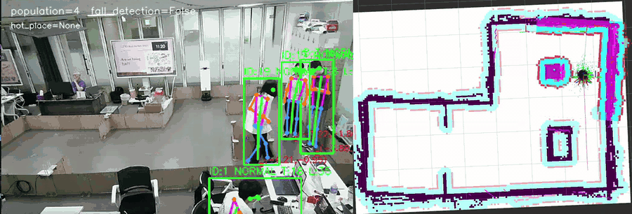
</p>
<p align="center"><i>왼쪽: CCTV가 3명 무리를 혼잡구역으로 확정 · 오른쪽: robot1 코스트맵에 진입 금지 원(자홍색)이 생기고 경로가 우회</i></p>

### 1-4. robot1 — 응급·AED 대응 FSM (`robot1_control`)

* 11개 상태 FSM. 평소에는 6개 지점을 1→2→…→6 순서로 **무한 순찰**하고, 미션이 끝나면 **중단된 순찰점부터** 다시 돕니다.
* `ExecuteMission` 액션 서버 · `EmergencyStop` 서비스 서버 · `RobotStatus`(1 Hz) 발행. Nav2 goal은 **이전 goal의 결과를 받은 뒤** 새 goal을 보내 충돌을 막습니다.
* **응급 흐름**: 이동 중 4초마다 경고음(880/440 Hz) → 도착 후 경고음 + 제자리 회전(0.35 rad/s, 4 s)으로 주변 인원 정리 →
  `/rgbd_fall_person_point` 최종 접근 좌표를 최대 10 s 대기(없으면 현장 대기) → 키오스크 "상황 종료"(`/emergency_end`) 후 순찰 복귀.
* 키오스크와는 `/rb1_standby`(터치 즉시 정지), `/rb1_service_end`(안내 종료·순찰 복귀), `/emergency_end`로 직접 연결됩니다.
* 혼잡구역은 Nav2 Keepout Filter(`config/robot1_nav2.yaml`)로 우회합니다.

### 1-5. robot3 — 후방 안내 추적 · 전방 짐 추종 (`robot3_control`)

robot3는 **카메라 방향으로 역할을 나눴습니다.** 안내할 때는 로봇이 앞장서고 승객이 뒤따르므로 **후방 웹캠**으로, 짐을 운반할 때는 승객이 앞장서므로 **전방 OAK-D**로 사람을 추적합니다.

<p align="center">
  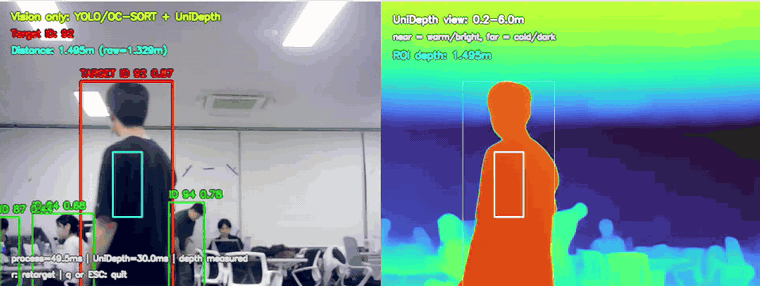
</p>
<p align="center"><i>후방 웹캠: 타깃 ID 유지(왼쪽)와 UniDepthV2 단안 깊이(오른쪽) — 개발 중 화면이라 tracker 표기가 OC-SORT로 남아 있습니다</i></p>

**후방 안내 추적 `guide_rear_tracker_node`**

* YOLO11s + DeepOCSORT로 사람을 추적하고, **UniDepthV2(ViT-S/14) 단안 깊이**로 거리를 잽니다.
  bbox 중앙 10% ROI에서 0.2–10 m 값만 남겨 P5–P95 절삭 median → 최근 3프레임 median.
* 180° 회전이 끝난 뒤(`/turn_complete`) **1.0 m 이내 최근접 사람**을 타깃으로 고정하고, ID가 끊기면 마지막 거리 ±0.5 m 안의 사람으로 이어 붙입니다.
* 최신 프레임 1장만 보관하고 추론은 별도 스레드에서 돌리며, 추적 결과는 추론 속도와 무관하게 **10 Hz**로 발행합니다.

**안내 주행 `guide_motion_node`**

* 기본은 **잠금(SYSTEM_LOCKED)** 상태라 cmd_vel을 내지 않습니다. 키오스크의 `/turn_around`를 받으면 odom yaw 누적으로 **180° 회전**(P 제어 0.14–0.45 rad/s, 허용 3°)한 뒤
  `/turn_complete=True`를 보내고 **DDS ACK를 확인**합니다(1 s × 최대 3회). 같은 토픽을 다시 받아 잠금을 풉니다.
* 아래 **5가지 조건을 모두 만족할 때만** Nav2 goal을 보내고, 하나라도 깨지면 goal을 취소하고 멈춥니다.

| # | 조건 |
|:---:|:---|
| 1 | `/robot3/mission_cmd`로 등록된 목적지 수신 |
| 2 | `/tracking_web == 1` (승객이 보임) |
| 3 | `0 < /target_depth ≤ 1.0 m` (승객이 1 m 안에서 따라옴) |
| 4 | 승객 중심 x가 화면 가운데 50% (160–480 px) — 벗어나면 제자리 정렬 회전 |
| 5 | 세 추적 토픽이 0.35 s 안에 갱신됨 |

**전방 짐 추종 `luggage_rgbd_tracker_node` + `luggage_follower_node`**

<p align="center">
  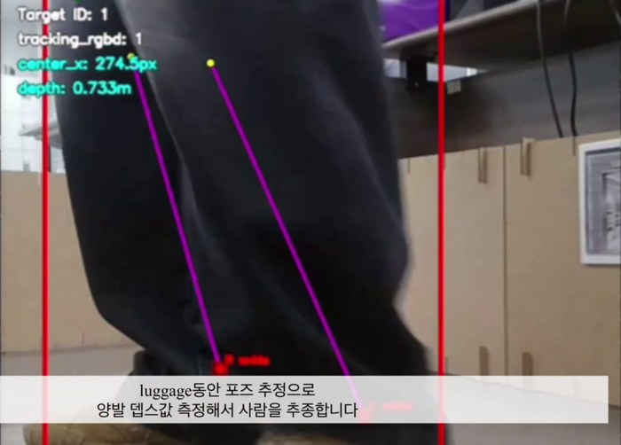
</p>

* `/carrying=True` 전에는 YOLO를 돌리지 않습니다. 시작 후 OAK-D RGB·Depth를 ApproximateTimeSynchronizer(slop 0.08 s)로 맞추고
  **YOLO11s-pose**로 사람과 keypoint를 얻습니다.
* 거리는 bbox 전체가 아니라 **양 발목 keypoint 주변 17×17 px depth 패치**(0.15–5 m)로 재고 두 발 중 가까운 값을 씁니다. 배경·바닥 depth가 섞이는 것을 줄이기 위한 선택입니다.
* 처음에는 **0.9 m 이내 최근접 사람**을 타깃으로 잡고, ID가 끊기면 마지막 거리 ±0.3 m 안의 사람으로 복구합니다.
* follower는 각속도 −0.0025·(cx−320)(±35 px 데드밴드, 최대 0.55 rad/s), 선속도 0.7 m 이하 정지 → 0.7–1.0 m 구간 0.12→0.40 m/s → 1.0 m 이상 0.40 m/s로 따라갑니다. 입력이 0.7 s 끊기면 정지합니다.

**제어권 정리** — robot3에는 cmd_vel을 내는 노드가 여럿이라, 토픽 신호로 한 번에 한 노드만 움직이게 했습니다.

| 신호 | 의미 |
|:---|:---|
| `/rb3_standby` → `/rb3_standby_done` | 순찰 goal 취소가 **결과까지 끝난 뒤** ACK |
| `/turn_complete` | 안내 주행 잠금 해제, 후방 타깃 선택 시작 |
| `/front_start = 1` (10 Hz) | 짐 추종 중 → 안내 주행·후방 추적 잠금 |
| `/service_end` | 추적 잠금 + 정지 → `/robot3/mission_complete` → `/start_patrol`로 순찰에 제어 반납 |

### 1-6. 승객 키오스크 · 관제 대시보드 (`ui/`)

<p align="center">
  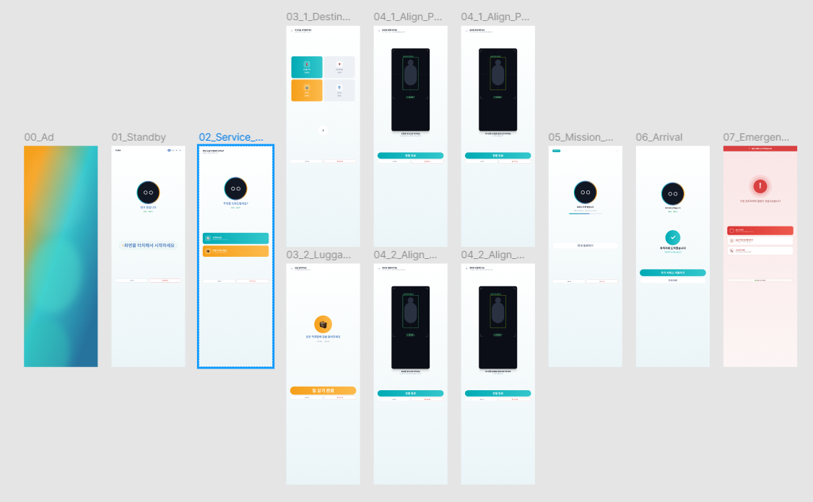
</p>

* **승객 키오스크** (`passenger_ui`): 00 광고 → 01 대기 → 02 서비스 선택 → 03 목적지/짐 싣기 → 04 승객 정렬 → 05 이동 중 → 06 도착, 응급 시 모든 화면에서 07 응급 화면으로 전환.
  하나의 Flask 앱을 AMR1(수동 정렬·응급 화면)과 AMR3(비전 정렬·짐 운반) 프로파일로 나눠 실행합니다.
* 로봇 직접 명령은 `std_msgs/Bool(True)`를 **정확히 1회** 발행하고 DDS ACK를 확인합니다. 자동 재발행이 없어 180° 회전이 중복되지 않습니다.
* **관제 대시보드** (`admin_ui`): SQLite를 읽기 전용으로 1초마다 조회해 로봇 상태·응급 기록·쓰러짐 스냅샷·로그를 보여 주고, CCTV 영상은 MJPEG로, 인원수는 SSE로 바로 갱신합니다.

<p align="center">
  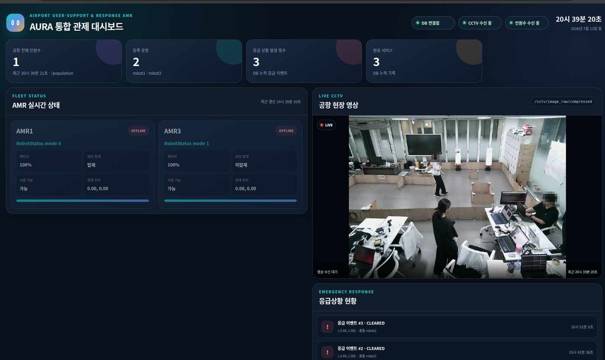
</p>

각 UI의 상세 동작은 [`ui/passenger_ui/README.md`](ui/passenger_ui/README.md), [`ui/admin_ui/README.md`](ui/admin_ui/README.md)에 정리했습니다.

---

## 2. 🧩 모듈 구조 (Package Architecture)

### 2-1. 계층 구조

```
① UI 계층        admin_ui(7000) · passenger_ui(5001/5003)        ← Flask (colcon 빌드 대상 아님)
② 중앙 계층      fleet_dispatcher · db_manager · crowd_keepout_mask
③ 로봇 계층      robot1_control · robot3_control
④ 인지 계층      cctv_perception
공용 인터페이스  fleet_interfaces (msg / action / srv)
```

### 2-2. 패키지별 노드

| 패키지 | 실행 파일 | 노드 이름 | 네임스페이스 | 역할 | 라인 |
|:---|:---|:---|:---:|:---|---:|
| `cctv_perception` | `cctv_detector_node` | `cctv_fall_crowd_node` | – | 쓰러짐·혼잡·인원수 감지, map 좌표 변환 | 1,140 |
| `fleet_central` | `fleet_dispatcher_node` | `fleet_dispatcher_node` | – | 미션 배차, 결과 통보 | 805 |
| | `db_manager_node` | `aura_db_manager_node` | – | SQLite 기록, 쓰러짐 스냅샷 저장 | 1,277 |
| | `crowd_keepout_mask_node` | `crowd_keepout_mask_publisher` | – | robot1 Nav2 keepout 마스크 | 325 |
| `robot1_control` | `robot1_mission_fsm_node` | `robot_mission_fsm` | `/robot1` | 순찰·안내·혼잡·응급 FSM | 1,092 |
| `robot3_control` | `robot3_mission_fsm_node` | `robot_mission_fsm` | `/robot3` | 중앙 미션 처리, 안내 위임 | 937 |
| | `robot3_patrol_node` | `waypoint_patrol_node` | `/robot3` | 6점 순찰, 혼잡구역 접근, 대기 핸드셰이크 | 1,087 |
| | `guide_rear_tracker_node` | `rear_person_vision_node` | – | 후방 웹캠 추적 + UniDepthV2 거리 | 2,030 |
| | `guide_motion_node` | `guarded_nav_to_goal` | – | 180° 회전, 조건부 안내 주행 | 2,241 |
| | `luggage_rgbd_tracker_node` | `rgbd_person_tracking_node` | – | 전방 OAK-D 추적, 발목 depth | 1,808 |
| | `luggage_follower_node` | `front_move` | – | 짐 운반 추종 주행 | 517 |

> 네임스페이스가 표시된 노드는 상대 토픽(`navigate_to_pose`, `status`, `cmd_vel` 등)을 쓰므로 반드시 해당 네임스페이스로 실행합니다(launch 파일에 반영됨).

### 2-3. 공용 인터페이스 (`fleet_interfaces`)

```text
# msg/RobotStatus.msg
string robot_id
uint8 mode
float64 battery_pct
geometry_msgs/PoseStamped pose
bool aed_loaded
bool available

uint8 MODE_IDLE=0
uint8 MODE_GUIDE=1
uint8 MODE_LUGGAGE_ASSIST=2
uint8 MODE_EMERGENCY_DISPATCH=3
uint8 MODE_ERROR=4
uint8 MODE_CHARGING=5
uint8 MODE_HOTPLACE_DISPATCH=6

# action/ExecuteMission.action
string mode
float64 dest_x
float64 dest_y
uint8 priority
---
bool success
string final_state
---
string current_mode
float64 progress_pct

# srv/EmergencyStop.srv
string reason
---
bool success
```

---

## 3. 🎨 시스템 설계 및 플로우 차트

### 3-1. 시스템 구성도

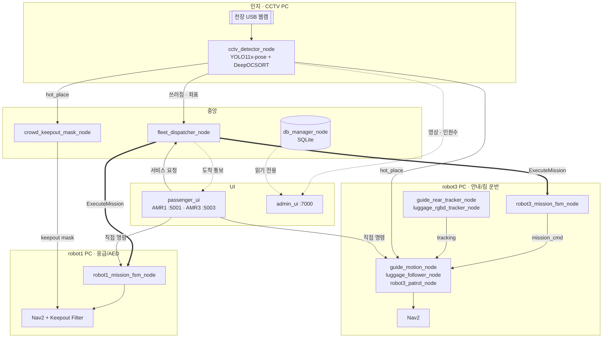

* 굵은 화살표는 액션(`ExecuteMission`), 실선은 토픽, 점선은 UI 표시용 데이터입니다. 토픽 이름은 [8장](#8--부록--노드--토픽--서비스-요약)과 [`docs/topics.md`](docs/topics.md)에 정리했습니다.
* `db_manager_node`는 CCTV·키오스크·로봇 상태 토픽 16개를 구독해 기록하며, `admin_ui`는 그 DB 파일을 읽습니다.

### 3-2. 응급 대응 시퀀스

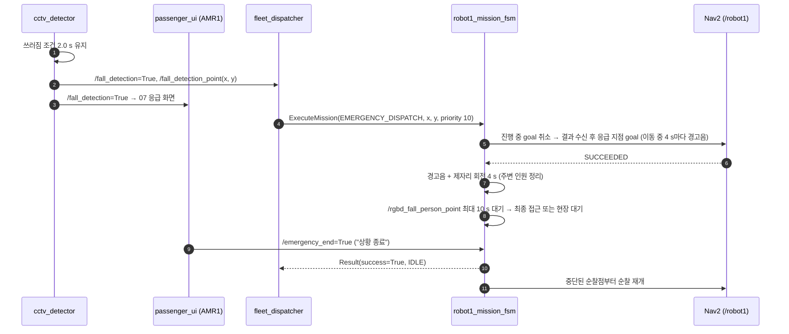

### 3-3. robot3 길 안내 — 제어권 이양 시퀀스

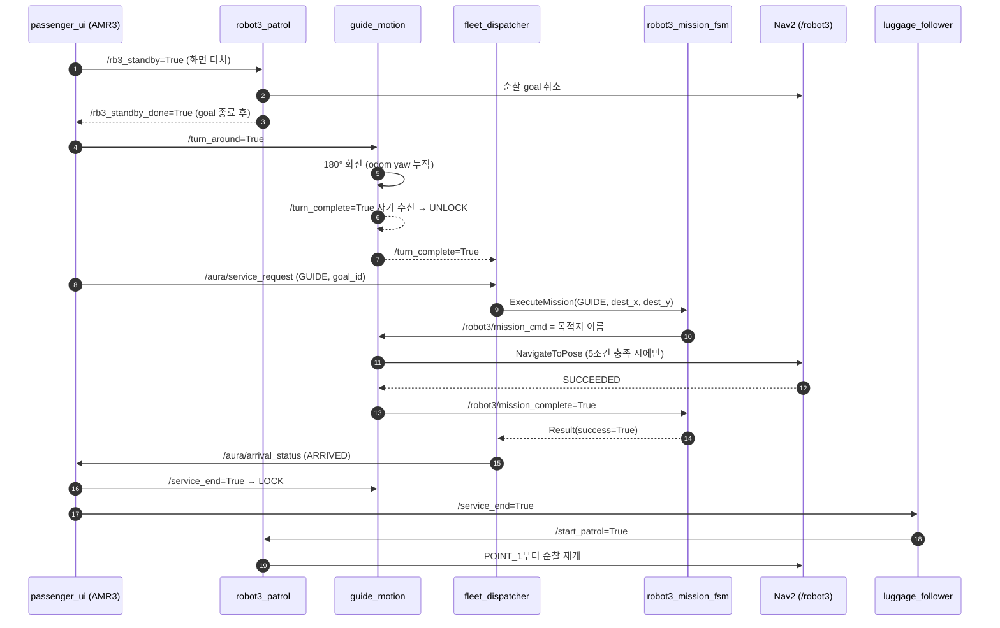

### 3-4. 안내 주행 상태도 (`guide_motion_node`)

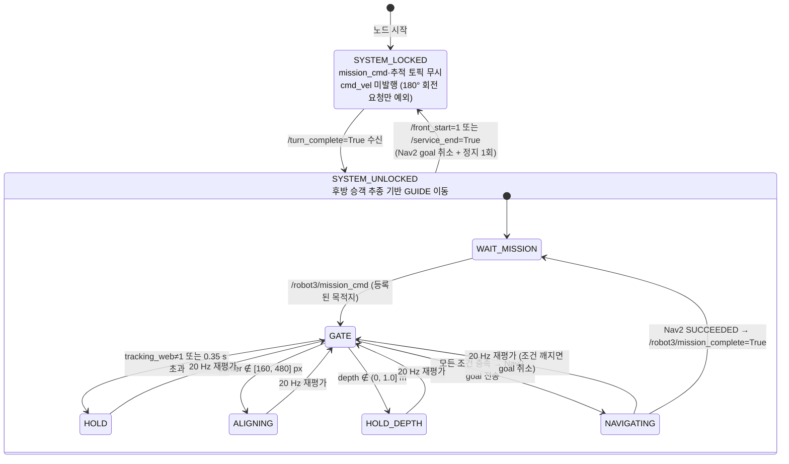

### 3-5. CCTV 처리 파이프라인 (`cctv_detector_node`)

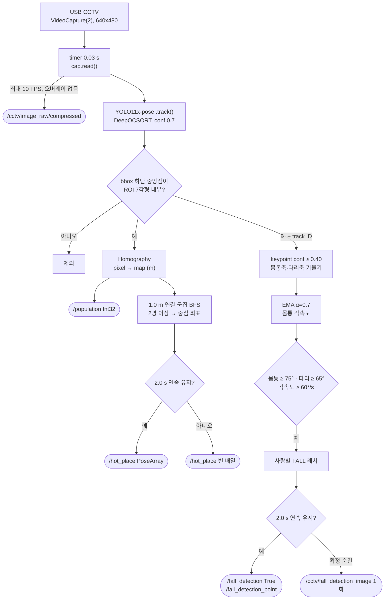

### 3-6. 테스트베드

<p align="center">
  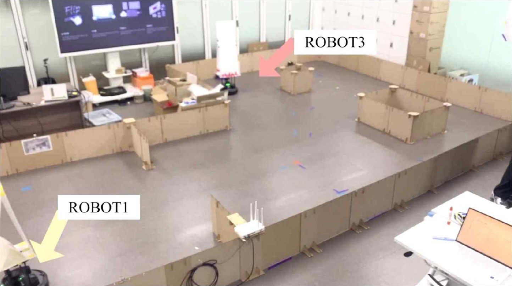
</p>

* 실습실에 골판지 벽으로 공항 구역을 만들고 SLAM으로 만든 맵(`maps/new_map.yaml`, 0.05 m/px)을 두 로봇이 공유했습니다.
* robot1은 a1 구역, robot3는 a3 구역을 순찰하며, CCTV는 높은 곳에서 전체 구역을 내려다봅니다.

---

## 4. 🖥️ 운영체제 환경 (OS Environment)

| 항목 | 버전 |
|:---|:---|
| **OS** | Ubuntu 22.04 LTS |
| **ROS Version** | ROS 2 Humble Hawksbill |
| **Language** | Python 3.10 |
| **Navigation** | Nav2 (TurtleBot4 navigation 패키지, AMCL 위치추정) |
| **Vision** | Ultralytics ≥ 8.4.63 (YOLO11 + DeepOCSORT) · PyTorch · UniDepthV2 |
| **UI** | Flask 3.x (관제 대시보드 · 승객 키오스크) |
| **DB** | SQLite (WAL) |
| **Middleware** | Fast DDS (모든 PC 같은 `ROS_DOMAIN_ID`) |

---

## 5. 🛠️ 사용 장비 목록 (Hardware List)

| 장비명 (Model) | 수량 | 비고 |
|:---|:---:|:---|
| **TurtleBot4** | 2 | robot1(응급·AED 대응), robot3(길 안내·짐 운반) |
| **OAK-D** | 1 | robot3 전방 RGB-D 카메라 — 짐 운반 시 승객 추적 |
| **USB 웹캠** | 2 | ① 천장 CCTV 고정캠(혼잡·쓰러짐 감지) ② robot3 후방 카메라(안내 시 승객 추적) |
| **PC** | 4 | PC1 CCTV·관제 대시보드 / PC2 중앙 배차·GUI / PC3 robot1 / PC4 robot3 (시연 배치 기준) |
| **키오스크 단말** | – | 스마트폰 브라우저로 승객 UI 접속 (AMR1, AMR3) |

> YOLO11x-pose(CCTV)와 YOLO11s + UniDepthV2(robot3)는 GPU 사용을 전제로 합니다(robot3 비전 노드 기본 `device=0`).

---

## 6. 📦 의존성 (Dependencies)

### 6-1. 시스템 패키지 (APT)

```bash
sudo apt update
sudo apt install ros-humble-desktop \
    ros-humble-turtlebot4-navigation ros-humble-turtlebot4-viz \
    ros-humble-nav2-bringup ros-humble-irobot-create-msgs \
    ros-humble-cv-bridge ros-humble-message-filters

# robot3 후방 웹캠 드라이버 (예시)
sudo apt install ros-humble-usb-cam ros-humble-image-transport-plugins
```

### 6-2. Python 패키지 — `requirements.txt`

```txt
numpy<2.0
opencv-python>=4.8
ultralytics>=8.4.63      # tracker="deepocsort.yaml"은 8.4.63부터 포함
torch>=2.0               # GPU는 pytorch.org의 CUDA 빌드 안내를 따름
torchvision>=0.15
packaging>=21.0
Flask>=3.0,<4.0
```

```bash
pip3 install -r requirements.txt
```

### 6-3. UniDepthV2 (robot3 후방 카메라)

`third_party/UniDepth`는 [UniDepth](https://github.com/lpiccinelli-eth/UniDepth) git submodule입니다.

```bash
git submodule update --init --recursive
pip3 install -e third_party/UniDepth
```

### 6-4. 모델 가중치

가중치는 저장소에 넣지 않았습니다. YOLO(`yolo11x-pose.pt`, `yolo11s.pt`, `yolo11s-pose.pt`)는 Ultralytics가 첫 실행 때 내려받고,
UniDepthV2(`lpiccinelli/unidepth-v2-vits14`)는 Hugging Face에서 내려받습니다.

### 6-5. ROS 2 패키지 의존 (`package.xml`)

| 패키지 | 주요 의존 |
|:---|:---|
| `fleet_interfaces` | `rosidl_default_generators`, `geometry_msgs`, `builtin_interfaces`, `std_msgs`, `action_msgs` |
| `fleet_central` | `rclpy`, `fleet_interfaces`, `geometry_msgs`, `nav_msgs`, `nav2_msgs`, `sensor_msgs`, `cv_bridge` |
| `cctv_perception` | `rclpy`, `std_msgs`, `geometry_msgs`, `sensor_msgs` |
| `robot1_control` | `rclpy`, `fleet_interfaces`, `nav2_msgs`, `action_msgs`, `irobot_create_msgs`, `builtin_interfaces` |
| `robot3_control` | `rclpy`, `fleet_interfaces`, `nav_msgs`, `nav2_msgs`, `sensor_msgs`, `action_msgs`, `message_filters`, `irobot_create_msgs` |

```bash
cd ~/aura_ws
rosdep install -r --from-paths src --ignore-src --rosdistro humble -y
```

---

## 7. ▶️ 실행 순서 (Usage Guide)

모든 PC는 같은 네트워크·같은 `ROS_DOMAIN_ID`를 사용합니다. 각 터미널에서 먼저 아래 두 줄을 실행합니다.

```bash
source /opt/ros/humble/setup.bash
source ~/aura_ws/install/setup.bash
```

### Step 0. 워크스페이스 빌드 (최초 1회, 모든 PC)

```bash
git clone --recurse-submodules https://github.com/wodud4143/DooSan_Robotics_Turtlebot_Project.git ~/aura_ws
cd ~/aura_ws
pip3 install -r requirements.txt
pip3 install -e third_party/UniDepth          # robot3 PC만
rosdep install -r --from-paths src --ignore-src --rosdistro humble -y
colcon build --symlink-install
source install/setup.bash
```

**빌드 확인**

```bash
ros2 pkg executables fleet_central     # fleet_dispatcher_node, db_manager_node, crowd_keepout_mask_node
ros2 interface show fleet_interfaces/action/ExecuteMission
```

---

### Step 1. 로봇 위치추정 + Nav2 (robot1 PC · robot3 PC)

TurtleBot4를 켠 뒤 각 로봇 네임스페이스로 위치추정과 Nav2를 띄웁니다. robot1은 Keepout Filter가 들어간 파라미터를 씁니다.

```bash
# robot1
ros2 launch turtlebot4_navigation localization.launch.py namespace:=/robot1 map:=$HOME/aura_ws/maps/new_map.yaml
ros2 launch turtlebot4_navigation nav2.launch.py namespace:=/robot1 params_file:=$HOME/aura_ws/config/robot1_nav2.yaml

# robot3
ros2 launch turtlebot4_navigation localization.launch.py namespace:=/robot3 map:=$HOME/aura_ws/maps/new_map.yaml
ros2 launch turtlebot4_navigation nav2.launch.py namespace:=/robot3

# (선택) RViz
ros2 launch turtlebot4_viz view_robot.launch.py namespace:=/robot1
```

RViz에서 `2D Pose Estimate`로 초기 위치를 잡고 `/robot1/navigate_to_pose`, `/robot3/navigate_to_pose` 액션이 보이는지 확인합니다.

---

### Step 2. CCTV 인지 (CCTV PC)

```bash
ros2 launch cctv_perception cctv.launch.py camera_index:=2 model_path:=yolo11x-pose.pt
```

> Homography 보정점(`IMAGE_POINTS` ↔ `MAP_POINTS`)과 ROI는 시연장 카메라 위치 기준 값입니다. 카메라나 맵이 바뀌면 `cctv_detector_node.py` 상단 값을 다시 측정합니다.

---

### Step 3. 중앙 노드 (중앙 PC)

```bash
export AURA_DB_PATH=$HOME/aura_data/amr_system.db     # admin_ui와 같은 값
ros2 launch fleet_central central.launch.py            # dispatcher + db_manager + keepout mask
```

---

### Step 4. robot1 미션 FSM (robot1 PC)

> ⚠️ 실행하면 2초 뒤 바로 순찰을 시작합니다. 주변에 사람·장애물이 없는지 확인하십시오.

```bash
ros2 launch robot1_control robot1.launch.py            # /robot1 네임스페이스, aed_loaded:=true
```

---

### Step 5. robot3 노드 (robot3 PC)

후방 웹캠 드라이버가 `/image_raw/compressed`를 발행해야 합니다(예: `usb_cam`). OAK-D 토픽(`/robot3/oakd/...`)은 TurtleBot4가 발행합니다.

```bash
ros2 run usb_cam usb_cam_node_exe                       # 후방 웹캠 → /image_raw/compressed

ros2 launch robot3_control robot3_vision.launch.py      # 후방·전방 추적 (GPU)
ros2 launch robot3_control robot3.launch.py             # 안내 주행·짐 추종·순찰·미션 FSM
```

모델·장치·OpenCV 창은 환경변수로 바꿀 수 있습니다: `AURA_GUIDE_YOLO_MODEL`, `AURA_GUIDE_YOLO_DEVICE`, `AURA_UNIDEPTH_MODEL_ID`,
`AURA_LUGGAGE_YOLO_MODEL`, `AURA_LUGGAGE_YOLO_DEVICE`, `AURA_ENABLE_GUI=0`(창 끄기).

---

### Step 6. 관제 대시보드 · 승객 키오스크

```bash
# 관제 대시보드 — db_manager_node와 같은 PC, 같은 AURA_DB_PATH
cd ~/aura_ws/ui/admin_ui
export AURA_DB_PATH=$HOME/aura_data/amr_system.db
python3 app.py                                          # http://<PC IP>:7000

# 승객 키오스크
cd ~/aura_ws/ui/passenger_ui
python3 run_all_ui.py                                   # AMR1 :5001 + AMR3 :5003 (LAN 접속 URL 출력)
```

키오스크 단말(스마트폰·태블릿) 브라우저로 출력된 URL에 접속합니다.

---

### Step 7. 동작 확인

```bash
ros2 topic echo /robot1/status --once        # mode, aed_loaded=True
ros2 topic echo /population                  # CCTV 인원수
ros2 topic echo /tracking_web                # 0 없음 / 1 보임 / 2 소실
ros2 topic hz /cctv/image_raw/compressed     # 최대 10 Hz
```

### 종료

각 터미널에서 `Ctrl + C` (역순: Step 6 → Step 1). 로봇 FSM은 종료할 때 0 속도를 한 번 보냅니다.

---

## 8. 📡 부록 — 노드 · 토픽 · 서비스 요약

전체 목록은 [`docs/topics.md`](docs/topics.md), 계층별 설명은 [`docs/architecture.md`](docs/architecture.md)에 있습니다.

### 8-1. 주요 토픽

| 토픽 | 타입 | 발행 → 구독 |
|:---|:---|:---|
| `/fall_detection` · `/fall_detection_point` | `Bool` · `PointStamped` | cctv → dispatcher, db_manager (`/fall_detection`은 AMR1 키오스크도) |
| `/hot_place` | `PoseArray` | cctv → keepout mask, robot3_patrol, dispatcher, db_manager |
| `/population` | `Int32` | cctv → admin_ui, dispatcher, db_manager |
| `/cctv/image_raw/compressed` | `CompressedImage` | cctv → admin_ui (원본 JPEG, 최대 10 FPS) |
| `/aura/service_request` · `/aura/service_end` | `String` (JSON) | passenger_ui → dispatcher, db_manager |
| `/aura/arrival_status` | `String` (JSON) | dispatcher → passenger_ui |
| `/robot1/status` · `/robot3/status` | `fleet_interfaces/RobotStatus` | 로봇 FSM → dispatcher, db_manager (1 Hz) |
| `/robot1/keepout_filter_mask` · `/robot1/keepout_costmap_filter_info` | `OccupancyGrid` · `CostmapFilterInfo` | keepout mask → robot1 Nav2 |
| `/rb1_standby` · `/rb1_service_end` · `/emergency_end` | `Bool` | AMR1 키오스크 → robot1 FSM |
| `/rb3_standby` → `/rb3_standby_done` | `Bool` | AMR3 키오스크·robot3 FSM → robot3_patrol → robot3 FSM |
| `/turn_around` → `/turn_complete` | `Bool` | AMR3 키오스크 → guide_motion → dispatcher, 키오스크, 후방 추적 |
| `/tracking_web` · `/tracking_web_center_pixel` · `/target_depth` | `Int32` · `Float32` · `Float32` | 후방 추적 → guide_motion (`/tracking_web`은 키오스크도) |
| `/carrying` · `/service_end` | `Bool` | AMR3 키오스크 → 전방 추적, follower (`/service_end`는 guide_motion도) |
| `/tracking_rgbd` · `/tracking_rgbd_center_pixel` · `/target_depth_rgbd` | `Int32` · `Float32` · `Float32` | 전방 추적 → follower (`/tracking_rgbd`는 키오스크도) |
| `/front_start` | `Int32` | follower → guide_motion, 후방 추적 (10 Hz) |
| `/robot3/mission_cmd` · `/robot3/mission_complete` | `String` · `Bool` | robot3 FSM → guide_motion / guide_motion·follower → robot3 FSM |
| `/start_patrol` | `Bool` | guide_motion·follower·robot3 FSM → robot3_patrol |

### 8-2. 액션 · 서비스

| 인터페이스 | 타입 | 서버 | 클라이언트 |
|:---|:---|:---|:---|
| `/robot1/execute_mission` · `/robot3/execute_mission` | `fleet_interfaces/action/ExecuteMission` | 로봇 미션 FSM | fleet_dispatcher |
| `/robot1/emergency_stop` · `/robot3/emergency_stop` | `fleet_interfaces/srv/EmergencyStop` | 로봇 미션 FSM | fleet_dispatcher |
| `/robot1/navigate_to_pose` · `/robot3/navigate_to_pose` | `nav2_msgs/action/NavigateToPose` | Nav2 | robot1 FSM / guide_motion · robot3_patrol · robot3 FSM |

---

## 9. 📂 디렉터리 구조

```
DooSan_Robotics_Turtlebot_Project/          # = 워크스페이스 루트 (~/aura_ws)
├── README.md
├── requirements.txt                        # pip 통합 의존성
├── config/
│   └── robot1_nav2.yaml                    # robot1 Nav2 파라미터 (Keepout Filter)
├── maps/
│   ├── new_map.pgm                         # SLAM 맵 (0.05 m/px)
│   └── new_map.yaml
├── docs/
│   ├── architecture.md                     # 계층별 구조 설명
│   ├── topics.md                           # 전체 토픽·노드 레퍼런스
│   └── images/                             # README 이미지·GIF
├── src/
│   ├── fleet_interfaces/                   # 공용 msg / action / srv (ament_cmake)
│   ├── fleet_central/                      # 중앙 계층 (ament_python)
│   │   ├── fleet_central/
│   │   │   ├── fleet_dispatcher_node.py    # 미션 배차
│   │   │   ├── db_manager_node.py          # SQLite 기록
│   │   │   └── crowd_keepout_mask_node.py  # Nav2 keepout 마스크
│   │   └── launch/central.launch.py
│   ├── cctv_perception/                    # CCTV 인지
│   │   ├── cctv_perception/cctv_detector_node.py
│   │   └── launch/cctv.launch.py
│   ├── robot1_control/                     # robot1 응급·AED FSM
│   │   ├── robot1_control/robot1_mission_fsm_node.py
│   │   └── launch/robot1.launch.py
│   └── robot3_control/                     # robot3 안내·짐 운반 스택
│       ├── robot3_control/
│       │   ├── guide_rear_tracker_node.py  # 후방 웹캠 추적 + UniDepthV2
│       │   ├── guide_motion_node.py        # 180° 회전 · 조건부 안내 주행
│       │   ├── luggage_rgbd_tracker_node.py# 전방 OAK-D 추적 (발목 depth)
│       │   ├── luggage_follower_node.py    # 짐 운반 추종 주행
│       │   ├── robot3_patrol_node.py       # 순찰 · 혼잡구역 접근
│       │   └── robot3_mission_fsm_node.py  # 중앙 미션 처리
│       └── launch/
│           ├── robot3.launch.py
│           └── robot3_vision.launch.py
├── ui/
│   ├── admin_ui/                           # 관제 대시보드 (Flask)
│   └── passenger_ui/                       # 승객 키오스크 (Flask app-factory)
└── third_party/
    └── UniDepth/                           # git submodule
```

---

## 10. 🧯 트러블슈팅

### 10-1. 개발 중 해결한 문제

| 구분 | 문제 | 해결 |
|:---|:---|:---|
| AMR | 서비스 종료 후 FSM이 초기 상태로 돌아가지 않음 | 서비스 종료 → `/robot3/mission_complete` → IDLE 복귀 → 순찰 재개 순서로 정리 |
| AMR | 좁은 통로에서 로봇이 인플레이션 영역에 갇힘 | 탈출 속도를 높이고 inflation radius를 0.2 m로 줄임 (`config/robot1_nav2.yaml`) |
| AMR | 미션 전환 시 Nav2 goal 충돌 | 기존 goal 취소를 확인한 뒤 새 goal 전송 + 미션 잠금(`_mission_lock`) |
| AMR | robot3의 여러 노드가 같은 `/robot3/cmd_vel`·Nav2를 사용 | 잠금 신호(`/turn_complete`, `/front_start`, `/service_end`)와 standby ACK로 한 번에 한 노드만 움직이게 설계 |
| Vision | 이미지 토픽 지연 | 원본은 압축 이미지(최대 10 FPS)로, 이벤트 이미지는 확정 순간 1회만 발행 |
| Vision | 순간적인 오검출로 출동 | 쓰러짐·혼잡 모두 2초 연속 유지될 때만 확정 |
| Vision | 좌표 오차와 화면 밖 오검출 | 다각형 ROI + bbox 하단 중앙점 Homography |
| Vision | 사람이 겹치면 추적 ID가 바뀜 | ByteTrack · OC-SORT · Deep-OC-SORT를 비교해 Deep-OC-SORT 채택 (아래 표) |

**Tracker 비교** (발표 자료 수치)

| Tracker | MOTA ↑ | IDF1 ↑ | FP ↓ | IDSW ↓ | MT ↑ |
|:---|---:|---:|---:|---:|---:|
| ByteTrack | 56.10 | 34.96 | 230,720 | 5,400 | 241 |
| OC-SORT | 62.86 | 34.55 | 145,336 | 6,443 | 208 |
| **Deep-OC-SORT (채택)** | **65.83** | **37.05** | **106,314** | 5,575 | 197 |

### 10-2. 빌드 · 실행 체크

| 증상 | 원인 | 조치 |
|:---|:---|:---|
| `Package 'fleet_interfaces' not found` | 인터페이스 빌드 전 다른 패키지 빌드 | `colcon build` 후 `source install/setup.bash` 다시 실행 |
| `deepocsort.yaml` 을 찾지 못함 | ultralytics 8.4.63 미만 | `pip3 install -U "ultralytics>=8.4.63"` |
| `ModuleNotFoundError: unidepth` | submodule 미설치 | `git submodule update --init` 후 `pip3 install -e third_party/UniDepth` |
| 로봇이 미션을 받지 못함, robot_id가 `robot_unknown` | FSM을 네임스페이스 없이 실행 | `robot1.launch.py` / `robot3.launch.py` 사용 (또는 `-r __ns:=/robot1`) |
| 응급 출동 로봇이 없음 | AED 로봇의 `aed_loaded`가 false | robot1을 `aed_loaded:=true`로 실행 |
| 대시보드에 "DB 연결 실패" | db_manager와 admin_ui의 DB 경로가 다름 | 두 프로세스에 같은 `AURA_DB_PATH` 지정 |
| 혼잡구역을 그대로 지나감 | robot1 Nav2에 Keepout Filter가 없음 | `params_file:=config/robot1_nav2.yaml`로 Nav2 실행 |
| `/tracking_web`이 계속 0 | 후방 웹캠 토픽이 없거나 180° 회전 전 | `/image_raw/compressed` 발행 확인, 회전 완료 후 추적 시작 |
| 키오스크가 print-only 모드 | ROS 환경을 못 찾음 | ROS setup을 source한 터미널에서 실행 (`AURA_ROS_SETUP`, `AURA_WS_SETUP`로 경로 지정 가능) |
| numpy 관련 오류 | numpy 2.x | `pip3 install "numpy<2.0"` |

---

## 11. 📝 자체 평가 및 향후 계획

**완성도 자체 평가: 95%** (발표 기준)

**구현한 것**

1. CCTV 한 대로 쓰러짐·혼잡·인원수를 동시에 판단하고 결과를 map 좌표로 넘기는 인지 파이프라인
2. 우선순위 기반 멀티 로봇 배차와 응급 미션 선점, 순찰 지점 복귀까지 이어지는 FSM
3. 카메라 방향으로 역할을 나눈 robot3 안내·짐 운반 추적과, 토픽 신호로 정리한 제어권 이양
4. 승객 키오스크 · 관제 대시보드 · SQLite 기록까지 연결한 전체 서비스 흐름

**보완할 점**

1. 로봇 FSM이 `RobotStatus.pose`를 원점으로 보고해, 중앙의 혼잡구역 배차(HOTPLACE_DISPATCH)는 현재 동작하지 않습니다. AMCL 위치 연동이 필요합니다(robot3는 순찰 노드가 직접 혼잡구역에 접근).
2. 추적 노드의 무효값(100.0)과 받는 쪽 유효성 검사를 한 규칙으로 통일해야 합니다.
3. robot3 목적지 테이블이 FSM과 안내 주행 노드에 나뉘어 있어 한 곳(파라미터 파일)으로 모아야 합니다.
4. 응급 최종 접근 좌표(`/rgbd_fall_person_point`)를 내는 로봇 측 RGB-D 노드를 붙여야 합니다.

**향후 계획**

* 대열(Formation) 주행으로 여러 로봇 동시 안내
* 로봇 직접 명령까지 중앙(Dispatcher) 경유로 통신 일원화
* 가상 여권(Virtual Passport) 연동 서비스
* LLM 기반 대화형 안내 인터페이스

**팀원별 기여**

| 이름 | 역할 | 담당 업무 |
|:---:|:---:|:---|
| 유용준 | Project Manager | 프로젝트 기획과 일정관리, SYSTEM DESIGN DOCUMENT, 발표자료 및 영상 제작 총괄. 시나리오별 GUI 목업으로 사용자 입장의 시연 흐름 구성 |
| 이재영 | Vision Director | CCTV 쓰러짐 판정·혼잡도(hot place) 로직과 환자 위치 추정(Homography), robot3 비전-주행 로직(후방 안내 추적·전방 짐 추종 추적과 주행 제어) 및 노드 간 제어권 정리, 시나리오별 AMR 순찰 알고리즘 총괄 |
| 윤태환 | AMR Director | 멀티로봇 안내 주행 Cost맵 중앙노드 설계, GUI·비전·중앙노드·AMR 통합 로직 총괄 |
| 정진목 | GUI Director | 고객 GUI 코딩, UI-중앙노드 통신 로직 설계·검증, 전체 개발 보조와 system 구조 정리·통합 총괄 |
| 신초희 | Vision Engineer | CCTV 비전 혼잡구역·쓰러짐(응급) 감지 로직, 로봇 비전 승객 검출·Tracking과 robot1 비전-주행 로직 개발 |
| 최인석 | AMR Engineer | 로봇 Nav2 코드 작성·검증, 중앙 시스템 통합과 robot3 비전-주행 로직 개발 |
| 박수빈 | AMR Engineer | SLAM 맵 좌표 지정, 장애물·사람 회피 Cost맵과 AED 출동 주행, AMR 순찰 알고리즘 개발 |

---

<p align="center">
  <b>Team AURA · Airport User-support & Response AMR</b><br>
  <i>안내는 친절하게, 응급은 가장 먼저.</i>
</p>
