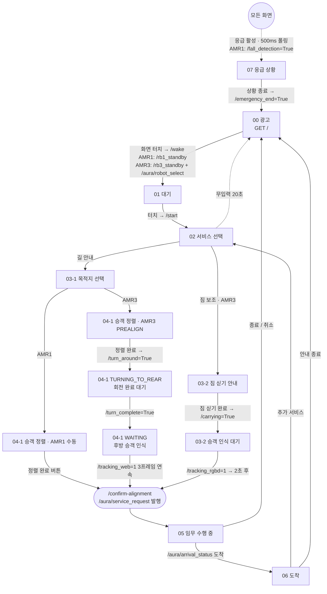

# AURA 승객 키오스크 UI (passenger_ui)

AMR1·AMR3에 올리는 승객용 키오스크 웹 UI입니다. 하나의 Flask app-factory 코드베이스를 로봇별 프로파일로 전환해 실행합니다.
카메라 영상은 표시하지 않고, 비전 노드의 추적 결과 토픽(`/tracking_web`, `/tracking_rgbd`)만 사용합니다.

## 로봇별 프로파일

| 항목 | AMR1 (`run_amr1.py`) | AMR3 (`run_amr3.py`) |
|---|---|---|
| 포트 | 5001 | 5003 |
| 서비스 | 길 안내, 응급 화면 | 길 안내, 짐 보조 |
| 승객 정렬 | `manual` (버튼으로 확인) | `tracking_int32` (`/tracking_web`, `/tracking_rgbd`) |
| 목적지(goal_id) | 화장실(`goal_2`) | 화장품 가게(`goal1_1`), 편의점(`goal1_2`) |
| 중앙 통신 | `/aura/service_request`·`/aura/arrival_status` 등 String(JSON) | 같음 |
| 로봇 직접 명령 (Bool True) | `/rb1_standby`, `/rb1_service_end`, `/emergency_end` | `/rb3_standby`, `/turn_around`, `/carrying`, `/service_end` |

좌표는 UI에 없고 `goal_id`만 보냅니다. 좌표는 중앙 `fleet_dispatcher_node`의 `GOAL_TABLE`이 가지고 있습니다.

## 화면 흐름



- 종료 경로(`/service-end`, `/cancel-service`, 무입력 타임아웃)에서 AMR1은 `/rb1_service_end`, AMR3는 `/aura/service_end`와 `/service_end`를 발행합니다.
- 응급 화면은 AMR1 UI에서만 뜹니다(`/fall_detection` 구독). 진행 중 미션이 있으면 `/aura/service_end`(EMERGENCY_INTERRUPTED)를 함께 보냅니다.

## 로봇 직접 명령 전송 방식

`std_msgs/Bool(True)`를 **정확히 1회** 발행합니다(QoS: RELIABLE, VOLATILE, KEEP_LAST depth 1).

1. 구독자 discovery 대기(최대 5초, `/turn_around`는 대기하지 않음)
2. 필요하면 상태 전환 콜백 실행(GUIDE: PREALIGN → TURNING_TO_REAR)
3. 1회 발행 후 `wait_for_all_acked`로 DDS ACK 확인(0.5초). 자동 재발행은 하지 않아 180° 회전이 중복되지 않습니다.

## GUIDE 정렬 상태머신 (AMR3)

`PREALIGN → (/turn_around) → TURNING_TO_REAR → (/turn_complete) → WAITING → (/tracking_web=1 연속 N프레임, 기본 3) → DETECTED → /aura/service_request`

- 회전 중에 들어온 추적값은 판정에 쓰지 않습니다.
- WAITING에서 0이나 2가 오면 연속 카운트만 초기화하고 계속 기다립니다(시간 제한 없음).

## 실행

```bash
pip install -r requirements.txt          # Flask 3.x

source /opt/ros/humble/setup.bash
source ~/aura_ws/install/setup.bash
cd <repo>/ui/passenger_ui

python3 run_all_ui.py    # AMR1(5001) + AMR3(5003) 동시 실행
python3 run_amr1.py      # AMR1만
python3 run_amr3.py      # AMR3만
```

- `launcher.py`는 rclpy를 불러올 수 없으면 ROS setup 파일을 source한 뒤 자신을 다시 실행합니다.
  경로는 `AURA_ROS_SETUP`(기본 `/opt/ros/humble/setup.bash`), `AURA_WS_SETUP`(기본 `~/aura_ws/install/setup.bash`)로 바꿀 수 있습니다.
- ROS가 없는 PC에서는 print-only 모드로 화면만 확인할 수 있습니다(발행 대신 로그 출력).
- 실행 시 같은 네트워크에서 접속할 LAN URL을 출력합니다.

## 주요 환경변수

`run_amr1.py`, `run_amr3.py`는 로봇 ID, 포트, 정렬 모드, 추적 토픽을 직접 지정합니다. 아래 변수는 `run.py`로 실행하거나 공통 설정을 바꿀 때 사용합니다.

| 변수 | 기본값 | 설명 |
|---|---|---|
| `AURA_ROBOT_ID` | `AMR1` | `AMR1` / `AMR3` |
| `AURA_HOST`, `AURA_PORT` | `0.0.0.0`, `5001` | 바인드 주소(네트워크 전체 공개, 인증 없음), 포트 |
| `AURA_SECRET_KEY` | 로봇별 개발용 키 | 세션 서명 키. 실제 배포 시 지정 |
| `AURA_INACTIVITY_TIMEOUT` | `20` | 02·03 화면 무입력 자동 종료(초) |
| `AURA_TRACKING_WEB_CONFIRM_FRAMES` | `3` | GUIDE 인식 확정 연속 프레임 수 |
| `AURA_DIRECT_COMMAND_WAIT_TIMEOUT` | `5.0` | 직접 명령 구독자 대기(초) |
| `AURA_DIRECT_COMMAND_ACK_TIMEOUT` | `0.5` | DDS ACK 대기(초) |
| `AURA_ALIGNMENT_INPUT_MODE` | AMR1 `manual`, 그 외 `tracking_int32` | `legacy_bool`은 구형 Bool 검출 토픽 방식 |

토픽 이름은 `app/config.py`의 `AURA_*_TOPIC` 변수로 바꿀 수 있습니다.

## 구조

```text
passenger_ui/
├── run_all_ui.py / run_amr1.py / run_amr3.py / run.py
├── launcher.py            # 로봇별 환경 설정, ROS 환경 자동 적용, Flask 실행
├── network_info.py        # LAN 접속 URL 출력
└── app/
    ├── __init__.py        # create_app(), 응급 핸들러 등록
    ├── config.py          # 환경변수 기반 설정, 로봇별 목적지
    ├── state.py           # 미션·정렬 상태 저장소(Lock + deepcopy)
    ├── ros_bridge.py      # rclpy pub/sub, 직접 명령(1회 발행 + ACK)
    ├── message_service.py # /aura/* String(JSON) payload 생성
    ├── routes/            # 화면(passenger.py), JSON API(api.py)
    ├── templates/         # 00~07 화면
    └── static/            # responsive.css, 화면별 폴링 JS
```

01~07 화면 왼쪽 아래의 "↩ 최초 화면" 버튼은 시연 중 화면을 처음으로 되돌리는 용도이며, ROS 명령은 보내지 않습니다.
